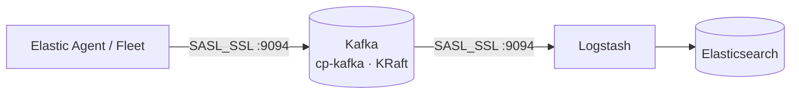

# Kafka Installer · TLS + SASL

[](https://github.com/cloudfactorybo/kafka-installer/releases/latest)
[](https://github.com/cloudfactorybo/kafka-installer/actions/workflows/release.yml)

-black)
[](LICENSE)

Instalador interactivo de **Apache Kafka** (imagen `confluentinc/cp-kafka`) sobre Docker, con **cifrado TLS** y **autenticación SASL/PLAIN**, en modo **KRaft**. Está pensado para recibir eventos de **Elastic Agent** y entregarlos a **Logstash**, y en pocos minutos deja un broker seguro y listo para producción en un único servidor.



---

## Contenido

- [Características](#características)
- [Requisitos](#requisitos)
- [Instalación](#instalación)
- [Qué se configura durante la instalación](#qué-se-configura-durante-la-instalación)
- [Archivos generados](#archivos-generados)
- [Puertos](#puertos)
- [Operación](#operación)
- [Conectar clientes](#conectar-clientes)
- [Gestión de certificados](#gestión-de-certificados)
- [Reinstalar o actualizar](#reinstalar-o-actualizar)
- [Solución de problemas](#solución-de-problemas)
- [Seguridad](#seguridad)
- [Limitaciones](#limitaciones)
- [Desarrollo y publicación de versiones](#desarrollo-y-publicación-de-versiones)
- [Licencia](#licencia)

---

## Características

| | |
|---|---|
| **Cifrado de extremo a extremo** | Una CA propia firma el certificado del servidor, que se entrega en un keystore y un truststore PKCS12. |
| **Autenticación** | SASL/PLAIN con usuario y contraseña, siempre sobre TLS. |
| **SAN dinámico** | Agrega al certificado las IPs físicas del host, IPs de NAT, VPN o balanceador y nombres DNS adicionales. |
| **Superficie mínima** | Solo se publica el puerto `9094` (SASL_SSL). Los listeners internos no salen del contenedor. |
| **Última versión automática** | Consulta Docker Hub para ofrecer la última versión estable de `cp-kafka`, o usa la que indiques. |
| **Reinstalación segura** | Respalda la instalación previa y permite reutilizar la CA, de modo que los clientes no necesitan un truststore nuevo. Conserva el `CLUSTER_ID` si ya hay datos. |
| **Sin Java en el host** | Si `keytool` no está instalado, usa el que trae la imagen de Kafka. |
| **Vencimientos vigilados** | Puede instalar un cron diario que avisa por syslog y al iniciar sesión 90 días antes de que venza un certificado. |
| **Verificación final** | Opcionalmente levanta el contenedor y prueba la conexión SASL_SSL de punta a punta. |
| **Descarga verificada** | El script de arranque comprueba la sintaxis y el checksum SHA-256 de la release antes de guardar el instalador. |

## Requisitos

| Componente | Detalle |
|---|---|
| Sistema operativo | Linux `amd64` o `arm64` |
| Docker | Docker Engine con el plugin **`docker compose` v2** |
| Herramientas | `openssl`, `curl` o `wget` |
| Permisos | `sudo` o root, para asignar las claves al uid 1000 del contenedor e instalar el cron |
| Red | Acceso a GitHub y Docker Hub durante la instalación. El puerto `9094/tcp` debe quedar abierto para los clientes. |

> No hace falta Java ni ZooKeeper.

## Instalación

### Opción 1: descargar y luego ejecutar (recomendada)

```bash
mkdir -p ~/kafka && cd ~/kafka
curl -fsSL https://raw.githubusercontent.com/cloudfactorybo/kafka-installer/main/get-kafka-installer.sh | bash
sudo ./install-kafka-seguro.sh
```

### Opción 2: en un solo paso

```bash
mkdir -p ~/kafka && cd ~/kafka
curl -fsSL https://raw.githubusercontent.com/cloudfactorybo/kafka-installer/main/get-kafka-installer.sh | bash -s -- --run
```

> El instalador trabaja en el **directorio actual**. Todos los archivos generados quedan ahí.

### Opciones

**Instalador** (`install-kafka-seguro.sh`):

| Opción | Descripción |
|---|---|
| `--version X.Y.Z` | Versión de `confluentinc/cp-kafka`. Por defecto se usa la última estable. |
| `KAFKA_VERSION=X.Y.Z` | Variable de entorno equivalente a `--version`. |
| `-h`, `--help` | Muestra la ayuda. |

```bash
sudo ./install-kafka-seguro.sh --version 7.9.0
```

**Script de arranque** (`get-kafka-installer.sh`):

| Variable | Descripción |
|---|---|
| `KAFKA_INSTALLER_REF=v1.0.0` | Descarga una release concreta en lugar de la última. |
| `KAFKA_INSTALLER_REPO=org/repo` | Usa otro repositorio (por ejemplo, un fork). |
| `KAFKA_INSTALLER_URL=https://…` | Descarga el instalador desde una URL directa. |

```bash
curl -fsSL https://raw.githubusercontent.com/cloudfactorybo/kafka-installer/main/get-kafka-installer.sh \
  | KAFKA_INSTALLER_REF=v1.0.0 bash
```

## Qué se configura durante la instalación

El instalador pide estos datos y muestra un **resumen editable** antes de generar nada:

1. **Versión de Kafka**: por defecto, la última estable de Docker Hub.
2. **Empresa o proyecto**: prefijo de los certificados y nombre del contenedor (`kafka-<empresa>`).
3. **Hostname** e **IP principal** del servidor.
4. **IPs del certificado**: las físicas detectadas, opcionalmente las virtuales de Docker o bridges, y otras de NAT, VPN o balanceador.
5. **Nombres DNS** adicionales.
6. **Host anunciado** (`advertised.listeners`): la dirección a la que los clientes se reconectan después del bootstrap. Ver [Clientes detrás de NAT](#clientes-detrás-de-nat).
7. **Usuario y contraseña SASL**.
8. **Contraseña SSL** (mínimo 6 caracteres) para la CA, el keystore y el truststore.
9. **Vigencia**: CA de 10 años y servidor de 5 años por defecto.
10. **Aviso de vencimiento** diario por cron (opcional).
11. **Arranque y prueba** de la conexión SASL_SSL (opcional).

## Archivos generados

> ⚠️ Estos archivos contienen **claves y contraseñas**. Están excluidos en `.gitignore`: no los subas a ningún repositorio.

| Archivo | Contenido |
|---|---|
| `docker-compose.yml` | Definición del servicio Kafka. |
| `kafka_server_jaas.conf` | Credenciales SASL del broker. |
| `certs/<empresa>-ca-cert.pem` | Certificado de la CA. Es lo que se distribuye a los clientes. |
| `certs/<empresa>-ca-key.pem` | Clave privada de la CA, cifrada con la contraseña SSL. |
| `certs/<empresa>-server-cert.pem`, `-server-key.pem` | Certificado y clave del servidor. |
| `certs/kafka.keystore.p12` | Keystore PKCS12 del broker. |
| `certs/kafka.truststore.p12` | Truststore PKCS12 para los clientes Java, como Logstash. |
| `client.properties` | Configuración de cliente lista para usar. |
| `client-verificado.properties` | Igual que la anterior, pero con verificación de hostname activa, para validar el SAN. |
| `server-ext.cnf` | Lista SAN del certificado. Edítala para agregar IPs o DNS. |
| `regenerar-cert.sh` | Renueva el certificado del servidor reutilizando la CA. |
| `revisar-cert.sh` | Muestra los días que faltan para cada vencimiento. |
| `comandos-rapidos.sh` | Funciones de operación diaria. |
| `data/` | Datos del broker. |
| `backup-AAAAMMDD-HHMMSS/` | Respaldo automático cuando se reinstala. |

## Puertos

| Puerto | Listener | Expuesto | Uso |
|---|---|:---:|---|
| `9094` | `SASL_SSL` | ✅ | Clientes externos (Elastic Agent, Logstash). |
| `9092` | `PLAINTEXT` | ❌ | Solo dentro del contenedor (inter-broker y herramientas locales). |
| `9093` | `CONTROLLER` | ❌ | Solo dentro del contenedor (quórum KRaft). |

```bash
sudo ufw allow 9094/tcp
```

## Operación

```bash
docker compose up -d                         # iniciar
docker compose ps                            # estado
docker logs -f kafka-<empresa>               # logs
docker compose restart                       # reiniciar
docker compose down                          # detener (conserva ./data)
```

**Comandos rápidos:**

```bash
source comandos-rapidos.sh
crear_client                # crea /tmp/client.properties dentro del contenedor
listar_topics
crear_topic  <topic>
producir     <topic>        # productor de consola
consumir     <topic>        # consumidor desde el inicio
ver_san                     # SAN del certificado actual
probar_tls   <ip_o_host>    # certificado que presenta el puerto 9094
ver_vencimiento [días]
ver_logs
estado
```

Configuración por defecto del broker: **retención de 48 horas**, **creación automática de topics** activada y factor de replicación 1.

## Conectar clientes

Todos los clientes usan `SASL_SSL` en el puerto `9094` con mecanismo `PLAIN`, y deben confiar en la CA generada.

### Logstash

Copia `certs/kafka.truststore.p12` al servidor de Logstash y configura el input:

```ruby
input {
  kafka {
    bootstrap_servers => "kafka-host:9094"
    topics            => ["mi-topic"]
    group_id          => "logstash"
    security_protocol => "SASL_SSL"
    sasl_mechanism    => "PLAIN"
    sasl_jaas_config  => "org.apache.kafka.common.security.plain.PlainLoginModule required username='USUARIO' password='CONTRASEÑA';"
    ssl_truststore_location => "/etc/logstash/certs/kafka.truststore.p12"
    ssl_truststore_password => "CONTRASEÑA_SSL"
    ssl_truststore_type     => "PKCS12"
  }
}
```

### Elastic Agent (output Kafka en Fleet)

En **Kibana → Fleet → Settings → Outputs → Add output → Kafka**:

- **Hosts:** `kafka-host:9094`
- **Authentication:** Username / Password, mecanismo **PLAIN**
- **SSL / Server SSL certificate authorities:** pega el contenido de `certs/<empresa>-ca-cert.pem`

### Clientes detrás de NAT

Kafka responde al bootstrap con el **host anunciado** (por defecto, el hostname del servidor), y el cliente se reconecta a esa dirección. Por eso, si hay clientes en redes distintas, usa un **nombre** en lugar de una IP y haz que cada cliente lo resuelva a la IP por la que llega:

```bash
# Cliente en el mismo segmento
echo "<IP_interna>  <hostname-kafka>" | sudo tee -a /etc/hosts

# Cliente detrás de NAT
echo "<IP_NAT>  <hostname-kafka>" | sudo tee -a /etc/hosts
```

Elastic Agent en Docker:

```yaml
extra_hosts:
  - "<hostname-kafka>:<IP_interna>"
```

> El nombre anunciado y todas las IPs por las que se llega al servidor deben estar en el SAN del certificado.

## Gestión de certificados

| Tarea | Cómo |
|---|---|
| Ver vencimientos | `./revisar-cert.sh [días_de_aviso]`. Sale con código `0` si está OK, `1` si está por vencer y `2` si ya venció. |
| Agregar IPs o DNS | Edita `server-ext.cnf`, ejecuta `sudo ./regenerar-cert.sh` y luego `docker compose restart`. |
| Renovar el certificado del servidor | `sudo ./regenerar-cert.sh` y luego `docker compose restart`. La CA no cambia, así que los clientes no se tocan. |
| Renovar la CA | Reinstala. Habrá que distribuir el nuevo truststore o la nueva CA a todos los clientes. |
| Avisos automáticos | Con el cron activado, los avisos se consultan con `journalctl -t kafka-<empresa>-cert` y aparecen al iniciar sesión. |

## Reinstalar o actualizar

Ejecuta de nuevo el instalador en el mismo directorio:

```bash
cd ~/kafka
curl -fsSL https://raw.githubusercontent.com/cloudfactorybo/kafka-installer/main/get-kafka-installer.sh | bash
sudo ./install-kafka-seguro.sh
```

Al detectar una instalación existente, el instalador:

- crea un respaldo en `backup-<fecha>/`;
- ofrece **reutilizar la CA** (requiere la misma contraseña SSL), y así los clientes siguen funcionando sin cambios;
- reutiliza el `CLUSTER_ID` de `./data` para no perder los datos.

Para actualizar solo la versión de Kafka, indica la nueva versión y reutiliza la CA.

## Solución de problemas

| Síntoma | Causa probable y solución |
|---|---|
| Kafka no arranca y aparece `INCONSISTENT_CLUSTER_ID` | `./data` pertenece a otro clúster. Si los datos no importan: `docker compose down && sudo rm -rf data/*`. |
| Error de handshake TLS o de *hostname verification* | La IP o el nombre usado no está en el SAN. Revisa con `ver_san` y corrige con `regenerar-cert.sh`. |
| El cliente conecta y luego falla, o hace *timeout* | El host anunciado no resuelve desde el cliente. Ver [Clientes detrás de NAT](#clientes-detrás-de-nat). |
| `SaslAuthenticationException` | Usuario o contraseña SASL incorrectos. |
| Las claves quedaron con permisos `644` | El instalador se ejecutó sin `sudo`. Vuelve a ejecutarlo con `sudo`. |
| No se puede contactar a Docker | El daemon está detenido o falta `sudo`: `sudo systemctl start docker`. |
| Probar desde otro equipo | `openssl s_client -connect <host>:9094 </dev/null` |

## Seguridad

- **Este repositorio no contiene credenciales.** Todas las contraseñas se piden de forma interactiva durante la instalación.
- Los archivos con secretos quedan con permisos restrictivos (`600`/`700`) y asignados al uid 1000 del contenedor.
- `client.properties` desactiva la verificación de hostname (`ssl.endpoint.identification.algorithm=`) para facilitar escenarios con NAT. Para validar el SAN, usa `client-verificado.properties`.
- No se exige certificado de cliente (`ssl.client.auth=none`). La autenticación es por SASL.
- Cada release publica el SHA-256 del instalador, y `get-kafka-installer.sh` lo verifica antes de guardarlo.
- Guarda una copia segura de `certs/` y de la contraseña SSL. Sin la clave de la CA no podrás renovar el certificado sin redistribuir el truststore.

## Limitaciones

- **Nodo único** (broker y controller en el mismo proceso) con factor de replicación 1: no hay alta disponibilidad.
- Un solo usuario SASL. Para agregar más, edita `kafka_server_jaas.conf` (`user_<nombre>="<contraseña>";`) y reinicia.
- Solo Linux.

## Desarrollo y publicación de versiones

```
.
├── install-kafka-seguro.sh        # Instalador
├── get-kafka-installer.sh         # Script de arranque: descarga y verifica la última release
├── .github/workflows/release.yml  # CI: valida la sintaxis y publica la release con SHA-256
├── .gitignore                     # Excluye certificados, claves y credenciales
└── LICENSE                        # Licencia MIT
```

Para publicar una versión nueva:

```bash
git commit -am "Descripción del cambio"
git push
git tag v1.0.1
git push origin v1.0.1
```

GitHub Actions valida la sintaxis de ambos scripts, genera `install-kafka-seguro.sh.sha256` y publica la release. Desde ese momento, `get-kafka-installer.sh` descarga automáticamente la nueva versión.

## Licencia

Distribuido bajo la [licencia MIT](LICENSE). Puedes usar, modificar y redistribuir este proyecto, también con fines comerciales, siempre que conserves el aviso de copyright.

Copyright © 2026 **CloudFactory Bolivia** y **AltairSec**.

---

Desarrollado y mantenido por **CloudFactory Bolivia** y **AltairSec**.
